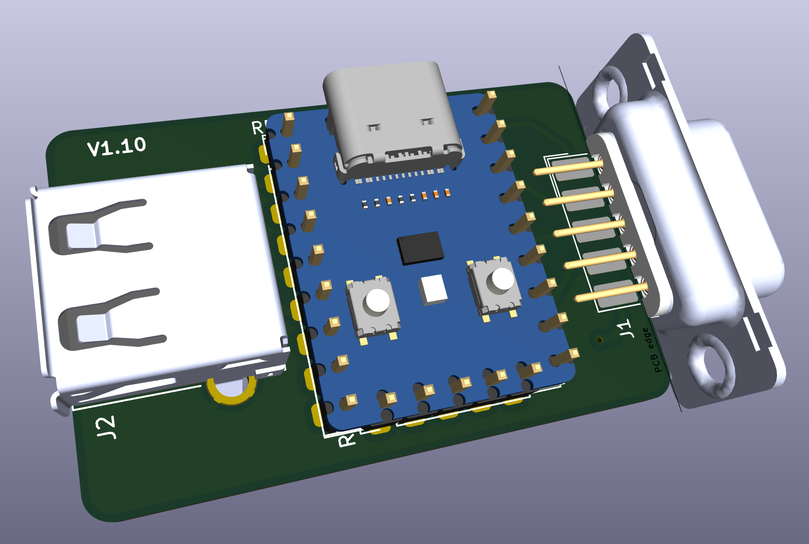
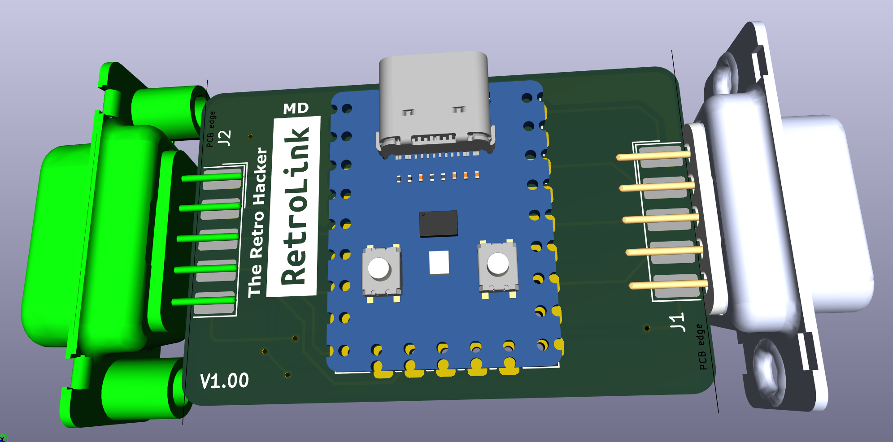
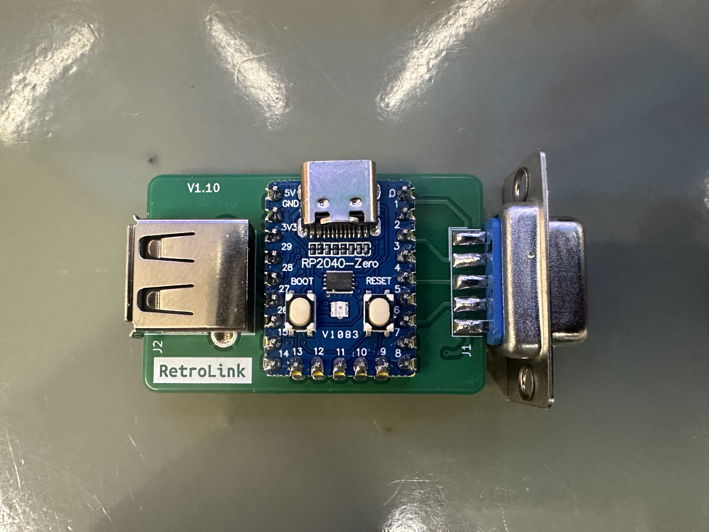
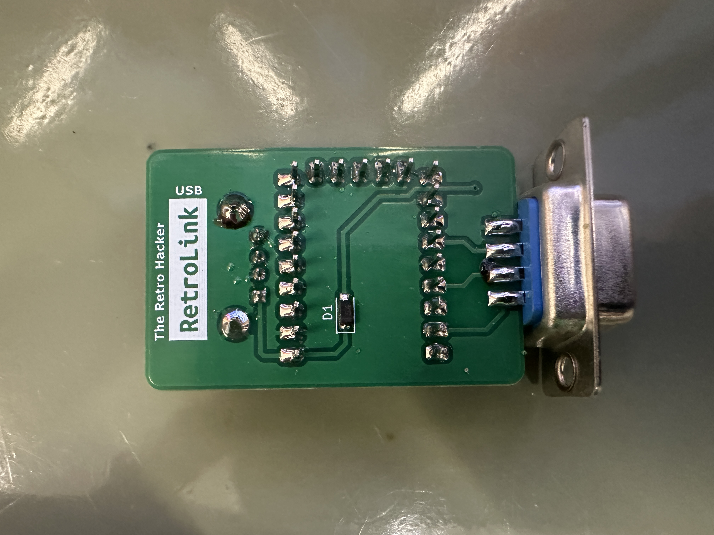
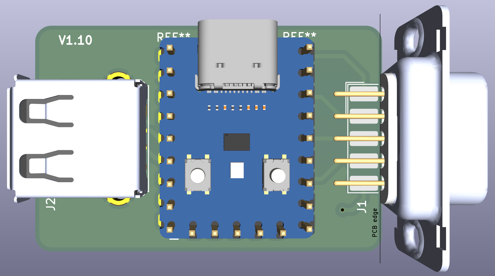
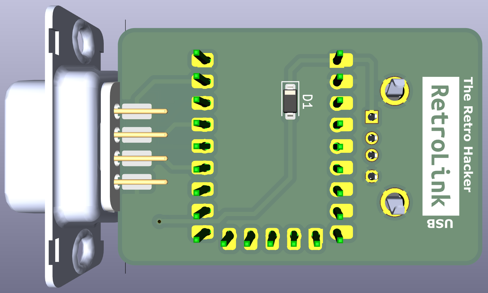
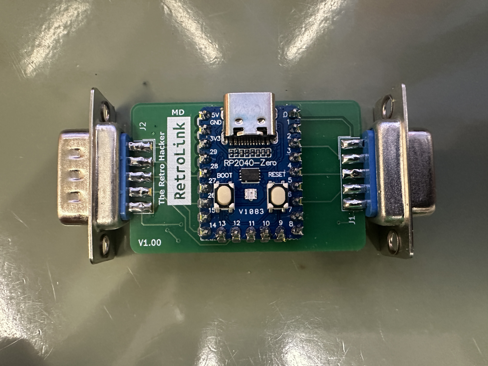
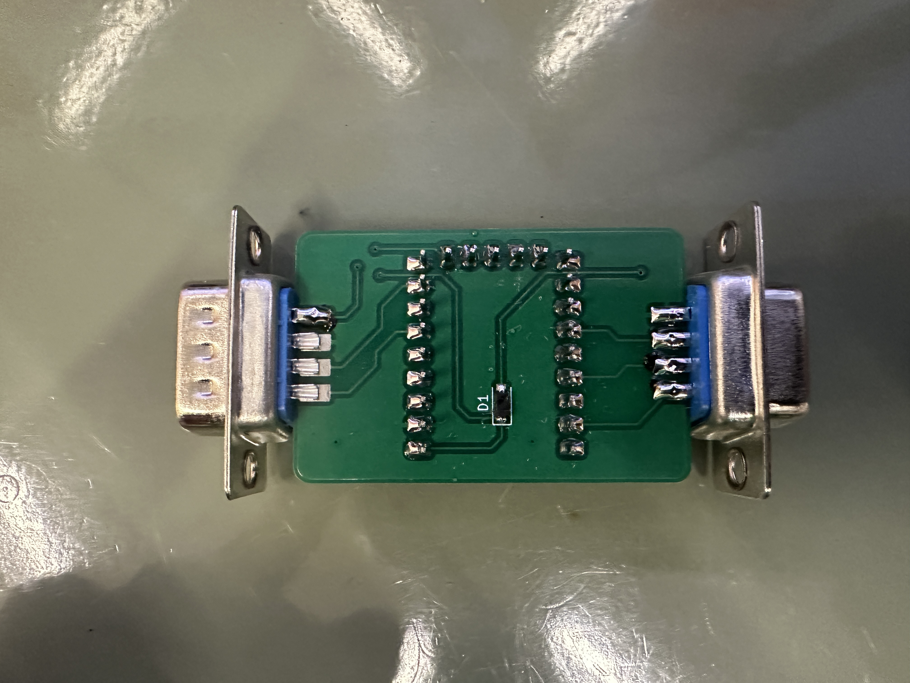
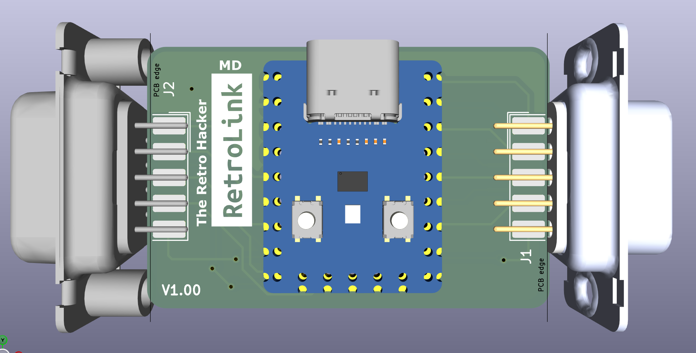
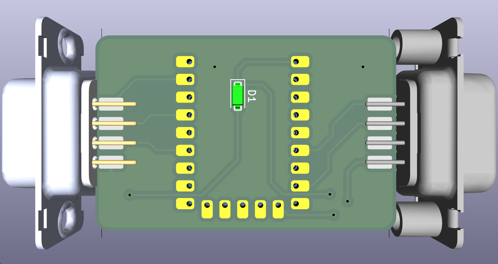

# The Retro Hacker RetroLink

RetroLink is an open-source hardware and firmware project for connecting controllers to classic MSX computers through the MSX DB9 General Purpose port. **RetroLink USB** connects USB HID joysticks and gamepads, or USB mice when flashed with the mouse firmware. **RetroLink MD** translates Mega Drive/Genesis 3-button and 6-button controller signals into MSX joystick signals. Both variants use an RP2040 Zero.

## Why RetroLink?

RetroLink started with a frustrating controller compatibility problem on the MSX. While passive or simple Mega Drive-to-MSX adapters (such as JoyMega) often work with older wired pads, they frequently run into trouble with modern wireless setups like the **8BitDo M30** and its Retro Receiver... especially on newer 8BitDo firmware versions. A controller might link up and even pass a diagnostic test like HIDTest, only to fail in actual games, SofaRun, or the Carnivore2 menu ([see the MSX Resource Center discussion](https://www.msx.org/forum/msx-talk/hardware/problem-with-8bitdo-joymega3)).

Mega Drive and MSX ports share the same 9-pin connector shape, but their wiring and protocols are fundamentally different.

Instead of relying on passive pin adaptation or custom polling routines inside each MSX program, **RetroLink puts an RP2040 Zero microcontroller in charge**. The adapter actively polls the controller on one side and presents clean, standard joystick (or mouse) signals to the MSX on the other. That same microcontroller-driven architecture also made **RetroLink USB** possible... bringing modern USB gamepads, joysticks, and mice to the MSX on a tiny, easily updatable board.

### RetroLink USB



**One board, two modes... switched with a quick firmware update.** RetroLink USB connects standard USB input devices to the MSX General Purpose port, and its behavior depends on the firmware loaded onto the RP2040 Zero:

- **USB Joystick & Gamepad Mode** ([`retrolink-joystick-1.10.uf2`](firmware/usb/retrolink-joystick-1.10.uf2)): Translates standard USB HID joysticks and gamepads (axes, D-pad hats, and primary buttons) into MSX directional inputs and Triggers A/B. Tested and working with controllers such as the Hyperkin Trooper 2, Dazz Dual Shock, generic USB Super Nintendo pads, and the Datafrog Wireless controller with its USB receiver (see the [full compatibility list](firmware/README.md#tested-usb-joysticks)).
- **USB Mouse Mode** ([`retrolink-mouse-1.00.uf2`](firmware/usb/retrolink-mouse-1.00.uf2)): Turns the exact same board into an MSX mouse adapter, answering the MSX port's strobe sequence with movement deltas and left/right button states (plus optional MSX-mouse joystick emulation when holding the left button on startup). Tested with Logitech mice, Red Dragon mice, and generic USB mice.
- **Easy Drag-and-Drop Updates**: Switching between a USB joystick and a USB mouse (or upgrading to a newer firmware release) takes seconds over USB-C. Hold `BOOT` while connecting the board to a PC and drop the desired `.uf2` file onto the `RPI-RP2` drive.

Hardware highlights (latest revision `1.10`):

- USB-A host receptacle for connecting wired or wireless-dongle USB HID devices.
- Female DE9 connector for the MSX joystick/general-purpose port.
- Powered directly from the MSX port (+5 V on DB9 pin 5) during normal use.
- `1N5819` Schottky diode protection to prevent USB-C programming power from feeding back into the MSX.

### RetroLink MD



**Built for high compatibility with original and modern Mega Drive controllers.** RetroLink MD replaces the USB-A port with a **male DE9 connector** for a Mega Drive / Genesis controller or wireless receiver, while keeping the **female DE9 connector** for the MSX.

- **Works with 8BitDo M30 & Recent Firmware Versions**: Designed specifically to solve the compatibility issues seen with passive adapters, RetroLink MD works reliably with **8BitDo M30 wireless controllers and receivers** (including recent firmware versions) across MSX games, SofaRun, and flashcart menus like Carnivore2, as well as standard 3-button and 6-button Mega Drive pads.
- **Active Microcontroller Translation**: Rather than passing raw multiplexed lines straight through to the MSX, the onboard RP2040 Zero generates the Mega Drive `TH/SELECT` polling sequence in firmware and outputs standard MSX directions and Triggers A/B (`B` → Trigger A, `C` → Trigger B).
- **Safe Port Handling & Updatable Firmware**: Monitors the MSX port's common line (pin 8), cancels opposing directions, and automatically releases all directional/trigger outputs if a controller is unplugged. If a future controller or receiver ever needs a timing tweak, the firmware can be updated via USB-C.

## Variants and Versions

| Variant | Input | Hardware | Software and firmware |
| --- | --- | --- | --- |
| RetroLink USB | USB HID joystick/gamepad, or USB HID mouse | Latest: [revision `1.10`](hardware/usb/1.10); earlier revisions under [hardware/usb](hardware/usb) | [Joystick source](software/usb/joystick) (firmware `1.10`), [mouse source](software/usb/mouse) (firmware `1.00`), and [UF2 artifacts](firmware/usb) |
| RetroLink MD | Mega Drive/Genesis 3-/6-button controller | Latest: [revision `1.10`](hardware/md/1.10); earlier revisions under [hardware/md](hardware/md) | [MD source](software/md) and [UF2 artifacts](firmware/md) (firmware `1.10`) |

See [firmware/README.md](firmware/README.md) for tested controllers, [docs/log.md](docs/log.md) for the hardware and firmware version history, and the individual firmware guides ([USB Joystick](software/usb/joystick/README.md), [USB Mouse](software/usb/mouse/README.md), and [MD](software/md/README.md)) for pinouts and technical details.

## DIY Build Guide & Board Previews

Both RetroLink variants are compact, beginner-friendly through-hole/edge-mount builds with just **four components** per board (one SMD diode, one RP2040 Zero module, and two connectors).

### PCB Components (BOM)

Quantities are per board for hardware revision `1.10`, matching the interactive BOMs ([USB iBOM](hardware/usb/1.10/bom/ibom.html), [MD iBOM](hardware/md/1.10/bom/ibom.html)) and CSV exports ([USB BOM](hardware/usb/1.10/production/bom.csv), [MD BOM](hardware/md/1.10/production/bom.csv)). AliExpress links are search placeholders—always verify dimensions, pinout, package, and ratings before ordering.

| Reference | Variant | Component / BOM value | Qty | PCB footprint / selection notes | AliExpress |
| --- | --- | --- | --- | --- | --- |
| RZ1 | USB & MD | RP2040 Zero module | 1 | `RP2040-Zero`; check module dimensions and pinout against the PCB. | [Search RP2040 Zero](https://www.aliexpress.com/w/wholesale-rp2040-zero.html) |
| J1 | USB & MD | DE9 female socket (`DE9_Socket`) | 1 | `DSUB-9_Socket_EdgeMount_P2.77mm`; edge-mount, 2.77 mm pitch (MSX side). | [Search DB9 female edge-mount](https://www.aliexpress.com/w/wholesale-db9-female-edge-mount.html) |
| J2 | **USB only** | USB-A receptacle (`USB_A`) | 1 | `TE_6364372-2`; through-hole USB-A female socket. Verify shell tabs and pin spacing. | [Search USB-A PCB socket](https://www.aliexpress.com/w/wholesale-usb-type-a-female-pcb.html) |
| J2 | **MD only** | DE9 male plug (`DE9_Pins`) | 1 | `DSUB-9_Pins_EdgeMount_P2.77mm`; edge-mount, 2.77 mm pitch (Mega Drive controller side). | [Search DB9 male edge-mount](https://www.aliexpress.com/w/wholesale-db9-male-edge-mount.html) |
| D1 | USB & MD | Schottky diode (`1N5819`) | 1 | `D_SOD-123`; **must be SMD SOD-123** (an axial DO-41 diode will not fit). Confirm polarity before soldering. | [Search 1N5819 SOD-123](https://www.aliexpress.com/w/wholesale-1n5819-sod-123.html) |

### Step-by-Step Assembly

1. **Order or Fabricate the PCB**: Use the KiCad project or production files under [hardware/usb/1.10](hardware/usb/1.10) for **RetroLink USB** or [hardware/md/1.10](hardware/md/1.10) for **RetroLink MD**. *(Make sure to use revision `1.10`, which includes the updated ground routing on the MD board.)*
2. **Open the Interactive BOM**: Download and open [hardware/usb/1.10/bom/ibom.html](hardware/usb/1.10/bom/ibom.html) or [hardware/md/1.10/bom/ibom.html](hardware/md/1.10/bom/ibom.html) locally in a web browser for interactive component placement and orientation checks.
3. **Solder the Protection Diode (`D1`)**: On the **bottom** of the PCB, solder the `1N5819` (`SOD-123`) Schottky diode first while the board lies flat, aligning the cathode mark with the silkscreen footprint.
4. **Mount the RP2040 Zero (`RZ1`)**: Solder the RP2040 Zero onto the **top** of the PCB using pin headers or directly via its castellated pads, with the USB-C port facing the board edge.
5. **Solder the Connectors (`J1` and `J2`)**:
   - Slide the MSX-side female DE9 edge-mount socket (`J1`) onto the right edge of the PCB and solder the top and bottom rows of contacts.
   - On **RetroLink USB**, insert the USB-A receptacle (`J2`) on the top side and solder its mounting tabs and signal pins on the bottom.
   - On **RetroLink MD**, slide the controller-side male DE9 edge-mount connector (`J2`) onto the left edge of the PCB and solder both rows of contacts.
6. **Flash the Firmware**:
   - Connect the RP2040 Zero to your computer with a USB-C data cable while holding the **BOOT** button (it will mount as a `RPI-RP2` USB drive).
   - Copy the appropriate `.uf2` file from [firmware/usb](firmware/usb) (`retrolink-joystick-1.10.uf2` or `retrolink-mouse-1.00.uf2`) or [firmware/md](firmware/md) (`retrolink-md-1.10.uf2`) to the drive.
   - To switch a RetroLink USB board between joystick and mouse modes later, simply re-enter `BOOT` mode and drop the other `.uf2` file onto the board.
7. **Print the Enclosure (Optional)**: 3D-printable two-piece snap-fit PLA cases (STLs, STEP files, and print instructions) are available in [hardware/usb/1.10/case](hardware/usb/1.10/case/README.md) and [hardware/md/1.10/case](hardware/md/1.10/case/README.md).

### Assembled Boards & PCB Previews

#### RetroLink USB

Assembled RetroLink USB board (top and bottom views):

| Assembled Top View | Assembled Bottom View |
| --- | --- |
|  |  |

3D CAD preview renders (revision `1.10` top and bottom):

| 3D Render (Top) | 3D Render (Bottom) |
| --- | --- |
|  |  | 

#### RetroLink MD

Assembled RetroLink MD board (top and bottom views):

| Assembled Top View | Assembled Bottom View |
| --- | --- |
|  |  |

3D CAD preview renders (top and bottom):

| 3D Render (Top) | 3D Render (Bottom) |
| --- | --- |
|  |  |

## Repository Layout

| Path | Purpose |
| --- | --- |
| [software/usb/joystick](software/usb/joystick) | USB joystick/gamepad firmware source using the Raspberry Pi Pico SDK, TinyUSB, and Pico-PIO-USB; also hosts sources shared with the mouse and MD builds. |
| [software/usb/mouse](software/usb/mouse) | USB mouse-to-MSX mouse firmware source for the same USB hardware. |
| [firmware/usb](firmware/usb) | USB joystick and mouse UF2 firmware artifacts. |
| [hardware/usb](hardware/usb) | USB KiCad project files, BOMs, production exports, and 3D-printable cases by hardware revision. |
| [software/md](software/md), [firmware/md](firmware/md), [hardware/md](hardware/md) | MD controller-to-MSX source, generated UF2 firmware, KiCad hardware revisions, and 3D-printable cases. |
| [images](images) | Assembled board photos and PCB preview renders used in this README. |
| [docs](docs) | Technical specification and version log. |
| [software/third_party/Pico-PIO-USB](software/third_party/Pico-PIO-USB) | Git submodule for GPIO-based USB host support on RP2040. |

## Firmware Build

### USB firmware

Initialize submodules after cloning:

```powershell
git submodule update --init --recursive
```

Build from the firmware source folder for the device you will connect:

```powershell
cd software\usb\joystick   # USB joysticks/gamepads
make
cd ..\mouse                # USB mice
make
```

Each build generates a versioned UF2 file for the same USB hardware:

```text
firmware/usb/retrolink-joystick-1.10.uf2
firmware/usb/retrolink-mouse-1.00.uf2
```

On Windows, the Makefile discovers Pico SDK-managed tools under `%USERPROFILE%\.pico-sdk`. Override `PICO_SDK_ROOT`, `PICO_SDK_PATH`, `PICO_TOOLCHAIN_PATH`, `CMAKE`, `CMAKE_MAKE_PROGRAM`, `PYTHON3_EXECUTABLE`, `PICOTOOL_DIR`, `PIOASM_DIR`, or `PICO_PIO_USB_PATH` if your toolchain is installed elsewhere.

### MD firmware

From the repository root, using the same Pico SDK toolchain:

```powershell
make -C software\md
```

Output: [firmware/md/retrolink-md-1.10.uf2](firmware/md/retrolink-md-1.10.uf2). The MD build does not use Pico-PIO-USB. See [MD build instructions and tests](software/md/README.md#build). Use the UF2 for the correct hardware variant.

## License

This project is licensed under the [Creative Commons Attribution-NonCommercial-ShareAlike 4.0 International License](http://creativecommons.org/licenses/by-nc-sa/4.0/).

- You may remix and adapt the material with proper attribution.
- Derivative works must be shared under the same license.
- Commercial use is not permitted without explicit authorization.

See [LICENSE.txt](LICENSE.txt) for the full license text. Third-party components retain their respective licenses.
