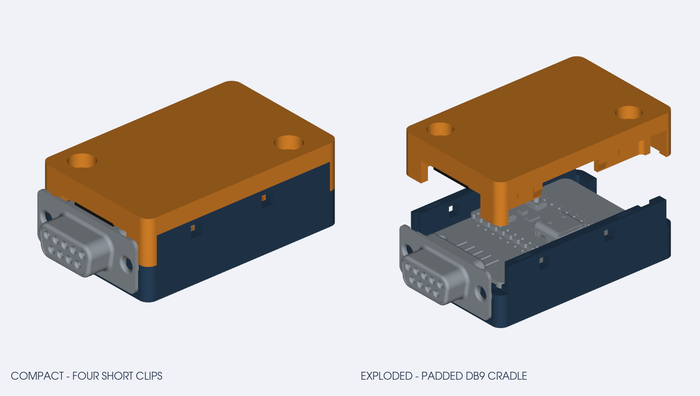

# RetroLink MD 1.11 compact four-clip case

Two-piece PLA enclosure for the [MD revision 1.11 PCB](../retrolink.kicad_pcb),
with a **male DB9 for the Mega Drive controller** and a **female DB9 for the MSX**.
The plastic envelope is **52.19 x 33.50 x 19.70 mm**. Both DB9 ends are shortened
by 1 mm relative to the previous 54.19 mm case to improve connector access.
Width and height still match the [USB 1.11 case](../../../usb/1.11/case/README.md).
The PCB, clips and locating stops stay in their previous assembly positions.

Four short internal clips, alignment keys, over-travel stops and tight PCB end
stops carry over from USB. Two **M3 nylon screws** through the revision 1.11 PCB
holes now close the case (see below); there are no long latches. USB-C is
enclosed: open the case and lift the PCB as needed for programming.

**Prototype, not physically print-tested or load-rated.** Digital fit checks do
not establish clip durability, connector retention force or compatibility with
every real cable/port housing. Test one complete pair before use on equipment.



## Print files

| File | Purpose |
| --- | --- |
| [Base STL](retrolink-md-1.11-base.stl) | MD bottom half, oriented with its outside face on the print bed. |
| [Lid STL](retrolink-md-1.11-lid.stl) | MD top half, oriented with its outside face on the print bed. |
| [Case STEP](retrolink-md-1.11-case.step) | Two assembled plastic solids for CAD editing. |
| [Generator](md_case.py) | MD connector openings, assembly checks and CLI. |
| [Tests](test_md_case.py) | Fourteen MD geometry regressions, including 1 mm trimming at each end, mirrored end profiles and M3 screw/nut recesses. |
| [Dependencies](requirements.txt) | Reuses the USB enclosure's pinned CAD dependencies. |

Dimensions are in **millimetres**. Slice at **100% scale**. Use both MD parts
together; reprint both halves for this revision. USB and MD halves are not
interchangeable. The preview includes electronics and female-end rubber pads,
but deliberately omits the known incorrect male connector model. STL and STEP
exports contain only the plastic case.

## M3 nylon screw mounting

The PCB has two 3.2 mm holes at **(3.05, 25.0)** and **(40.05, 3.0) mm** from its
lower-left corner (KiCad circle centres 105.2, 77.25 and 142.2, 99.25 mm). Both
sit beside a clip, so the screw head is in the **roof** (above the clip beams)
and the nut is trapped under the **floor**. Dimensions are shared with the
[USB case](../../../usb/1.11/case/README.md#m3-nylon-screw-mounting):

- **M3 x 16** nylon socket-head cap screw (head 5.68 x 3.0 mm max) and M3 nylon
  hex nut (5.5 mm across flats x 2.4 mm); nut dimensions are standard values,
  not measured.
- Head recess 6.2 mm diameter x 3.3 mm deep in the lid, over a 1.0 mm roof boss.
- Nut trap 5.7 mm across flats x 3.4 mm deep under the base, with a 1.2 mm
  ceiling, below the 3.2 mm underside solder keepout.
- The recesses stay clear of both DB9 openings and the male connector, which is
  not covered by the (incorrect) male model; recheck against the real part.

Seat the nuts from below before closing, then fit the screws from the roof and
tighten gently by hand. Fit is checked against the base, lid, PCB holes and
components, not by a print or torque test.

## Geometry and connector access

| Feature | Default |
| --- | --- |
| Plastic envelope, excluding exposed connectors | **52.19 x 33.50 x 19.70 mm** |
| PCB | 43 x 28 x 1.6 mm; 2 mm corner radius |
| Side walls / roof / floor | 2.4 mm, except local pad recesses; DB9 end walls shortened by 1 mm |
| Individual clip lengths, including roots | 14.7 / 14.1 mm |
| Clip beams / root radius | 1.2 x 4.8 mm / 1.2 mm in the bending plane |
| Clip engagement | 0.20 mm nominal |
| PCB lengthwise allowance | 0.10 mm per end, **0.20 mm total nominal travel** |
| Alignment-key clearance | 0.15 mm per mating face |
| Male DB9 rear-shell opening | 20.4 mm wide x 11.9 mm high, mirrored from the female end |
| Female DB9 rear-shell opening | 20.4 mm wide x 11.9 mm high |
| Programming opening | None; USB-C remains internal |

The male end uses a mirrored copy of the female end's opening, pad recesses,
wall thickness and low split seam. The old male-specific circular through-passages
remain removed; shortening also eliminates the shallow mounting reliefs at the
outermost ends. The two end profiles are checked for matching geometry, not
merely equal opening dimensions.

This change follows the reported error in the supplied male connector model.
The female flange remains exposed as before. The actual male flange and plug
clearance must be verified on the real connector before use; the incorrect
model is not evidence of fit for the replacement profile.

The main PCB matches the USB outline, but the RP2040 Zero sits **2.835 mm farther
toward the male DB9**. Its adjacent clip over-travel stops are repositioned to
avoid the module substrate. Board end stops and PCB supports remain in place;
shortening the ends does not add PCB travel or move the electronics.

### Size excludes protruding connectors

The 52.19 mm dimension measures only the plastic, from x=-5.75 to x=46.44 mm
in PCB coordinates. Do not use the known incorrect male model to infer the
finished adapter's tip-to-tip length.

## Connector support and rubber pads

The female **MSX end** retains the USB design's padded metal-backshell cradle.
Fit **two soft nonconductive rubber or silicone strips, 1.5 x 12 x 1 mm each**:

- Place one under and one above the female connector's rear flat metal shell.
- Use approximately Shore A 20-30 material. Do not substitute hard shims.
- Nominal pad compression is 0.20 mm each; each contact land is 18 mm2.
- Trim the former 2 mm-wide pads to 1.5 mm so they remain fully supported within
  the shortened end. This reduces the contact area; recheck frictional retention.
- Keep pad plus adhesive thickness at 1 mm. Start with a dry fit without pads,
  then check that adding them does not make closing force excessive.

The intended MSX extraction load path is case -> pad friction -> metal shell.
This is **not positive flange capture**. If the pads slip, the PCB and solder
joints can still carry extraction force. Tight PCB end stops do not replace
connector strain relief.

The mirrored male end includes matching pad recesses, but **male-end pad fit,
compression and grip are not validated**, because its model is incorrect.
Do not install pads there without measuring the actual metal contact lands.
Do not stuff pads around pins. Hold the exposed connector shell when
disconnecting a tight controller plug; do not use the case as a lever.
Grip and cycle-life testing remain necessary on both ends.

## Printing and assembly

Use PLA with a 0.4 mm nozzle and 0.20 mm layers as a starting point:

- Four perimeters, five top/bottom layers and 25-35% infill.
- Keep the supplied print orientations so the short arms run along layers.
- **Local supports are needed under all four horizontal clip arms.** Permit
  supports to start on part surfaces, not only on the print bed; inspect the
  slicer preview. Start with a removable 0.20 mm support-interface gap.
- The approximately 3.1 mm receiver windows should normally bridge, but check
  your printer's capability. Remove supports without bending clips outward.
- Prefer ordinary PLA, not brittle silk/filled blends. Avoid hot environments.

1. Disconnect all cables. Dry-fit the empty halves and verify gentle engagement
   of all four hooks before installing the board.
2. Lower the PCB onto its four support lands, male DB9 at one end and female at
   the other. Check the real male connector against the revised opening before
   closing; do not press on the pins or diode.
3. Fit the two rubber strips at the female MSX end after the unpadded fit is
   satisfactory. Align the stepped ends and alignment keys, then press near each
   clip. Stop if anything binds or a pad holds the seam open.
4. Check all four receiver windows and test plug clearance on unpowered spare
   connectors. Test that the female metal shell does not slide within the case
   under a gentle disconnected hand load.
5. Open by pressing each hook inward through its window with a blunt plastic
   tool and lifting that corner only enough to release it. Do not lever against
   still-engaged hooks or force a clip beyond its internal stop.

The clips are intended for occasional servicing, not repeated flexing.

## Regeneration

The MD source imports shared primitives, short clips, print orientations and
export validation from [the USB generator](../../../usb/1.11/case/case.py).
Keep that folder at its repository-relative location when regenerating; it is
not needed just to print the supplied STLs. This avoids maintaining two diverging
versions of the same clip design.

Python 3.13 was used. From this folder in PowerShell:

```powershell
python -m venv .venv
.\.venv\Scripts\python.exe -m pip install -r requirements.txt
.\.venv\Scripts\python.exe md_case.py
.\.venv\Scripts\python.exe -m unittest discover -s . -p test_md_case.py -v
```

The MD CLI keeps the exterior dimensions fixed. Available fit adjustments:

| Option | Supported range |
| --- | --- |
| `--board-end-clearance` | 0.05-0.20 mm per end |
| `--key-clearance` | 0.12-0.25 mm |
| `--hook-engagement` | 0.15-0.25 mm; lower values reduce both closing force and retention |
| `--pad-compression` | 0.10-0.20 mm per female-end rubber pad |

Use `--output .\trial` for alternative exports without replacing the defaults.
Changes to module mounting height, connector models or outside dimensions need
a new CAD fit review; the MD CLI deliberately does not expose size-changing
parameters.

For component checks excluding the known incorrect male model, export MD 1.11
with KiCad 10:

```powershell
$assembly = Join-Path $env:TEMP 'retrolink-md-1.11-fit.step'
& 'C:\Program Files\KiCad\10.0\bin\kicad-cli.exe' pcb export step `
    --force --user-origin '102.15x102.25mm' --output $assembly ..\retrolink.kicad_pcb
.\.venv\Scripts\python.exe md_case.py --assembly $assembly
Remove-Item $assembly
```

The local origin is the PCB lower-left corner, z=0 at its underside; +X points
toward the female DB9 and +Y toward the internal USB-C socket.

The generator requires the expected original assembly bounds, identifies the
known incorrect male solid by its bounds and volume, and prints an explicit
warning before excluding it from checks and the preview. It fails if the
signature is not recognized. No PCB or component source model is modified.
When a corrected male model becomes available, update this validation path
rather than continuing to exclude it.

Validation covers:

- Exactly 1 mm removed from each previous end, unchanged width/height, four clips and 0.20 mm PCB travel.
- No nominal PCB, half-to-half or remaining MD component overlap.
- Board and lid insertion at twelve sampled heights, excluding the male connector.
- Mirrored end profiles, removed through-passages and a closed USB-C side.
- Shifted-module clearance, solder keepouts, clip release and over-travel stops.
- Two female-end pad lands contacting only the metal backshell.
- Connected, watertight print meshes at bed z=0 and a two-solid STEP round-trip.
- M3 nylon screw and nut clearance against both halves, PCB holes and components.
- Fourteen MD tests plus fifteen USB regression tests.

These are geometric checks, not a slicer simulation, material deformation model,
mechanical load test or electrical validation.
